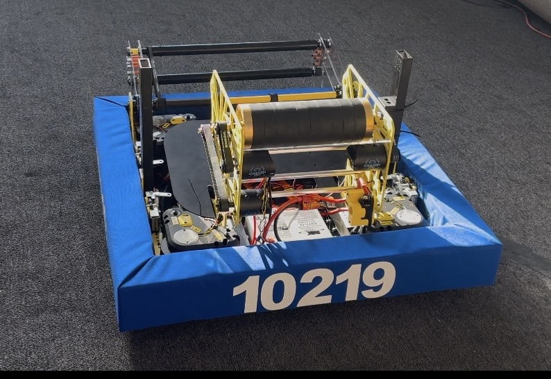
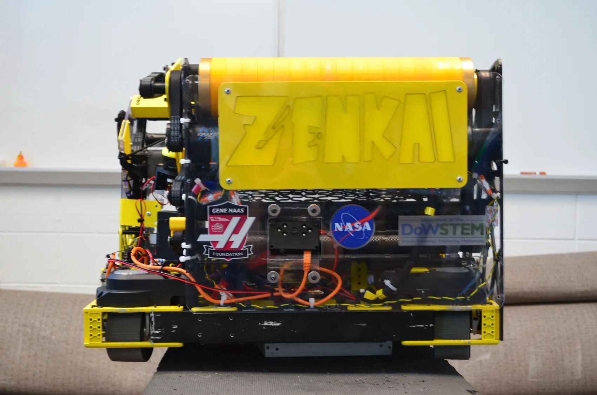
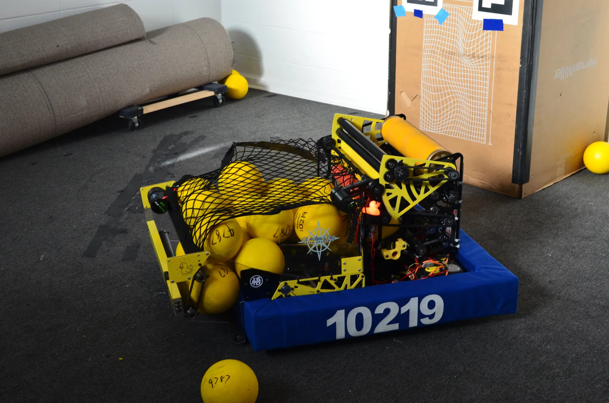

# Rebuilt-Tallahassee
FRC Team 10219's 2026 FRC robot code for REBUILT. Our robot's code is written in Java and is based on WPILib's Java control system, with logging and replay built on AdvantageKit and the AdvantageKit drive + vision template.

The code is divided into several packages, each responsible for a different aspect of robot function. This README explains the function of each package, some highlights of the architecture, and a few of the variable naming conventions used. Additional information about each specific class can be found in that class's Java file.

---

## Chicken Little → Zenkai

We competed at the Orlando Regional with our first robot, **Chicken Little**, and didn't do too well.



Rather than patch what we had, we tore it down and rebuilt both the robot and the codebase into **Zenkai**, named after the Dragon Ball Z concept of a Saiyan returning stronger after recovering from a near-loss. The rebuild paid off: Zenkai performed *way* better at the Tallahassee Regional.

<p align="center">
  
  
</p>

---

## Code Highlights

### Multi-Robot Configuration with IO Abstraction

Every subsystem is split into a logic class and a hardware-facing `IO` interface, with concrete implementations for each robot environment. This is the AdvantageKit IO pattern, applied across the whole codebase:

- `*IOTalonFX` for real CTRE Phoenix 6 hardware
- `*IOSim` for desktop simulation, using WPILib's `FlywheelSim`, `DCMotorSim`, etc.
- A bare `*IO` interface with default no-op methods, used as a fallback when a particular robot doesn't have that mechanism

`Constants.robot` selects between three robot types:
- `COMPBOT` for the competition robot
- `PRACBOT` for the practice / second robot, which has its own `PracTunerConstants` for swerve calibration
- `SIMBOT` for simulation only

`RobotContainer` wires up the correct IO implementations per robot via a `switch` statement, so the same code deploys to any of them without changes elsewhere.

### Goal / State Machine Pattern

`Drive`, `Superstructure`, and `Intake` all share the same architecture: a public `Goal` enum (what we want the subsystem to do) and an internal `State` enum (what it's actually doing right now). State is re-evaluated every `periodic()` from goal plus sensor inputs, and outputs are applied based on state. This keeps command code clean (just `setGoal(...)`) and makes the entire robot's behavior visible through AdvantageScope, since both the goal and the state are logged every loop.

For example, `Drive` automatically transitions between `DRIVING` and `DRIVING_REDUCED` based on whether the superstructure or intake is drawing heavy current, applying a tunable speed multiplier to all motion. Drivers don't have to think about it; the robot just gets gentler with the battery during high-load actions.

### Zone Controller — Set-Theoretic Field Regions

A core feature of this codebase is the zone system in `frc.robot.zonecontroller`, inspired by the architecture FRC Team 4481 (Team Rembrandts) shared in their 2026 build thread. Zones are objects defined by primitives:

- `RectangleZone`, `CircleZone`, `PolygonZone` for geometric primitives
- `AvoidZone` for explicit "do not enter" regions
- `CompositeZone` for set-algebraic combinations

Any `Zone` can be combined with any other `Zone` using:
- **Union** (`A ∪ B`) via `a.union(b)`
- **Intersection** (`A ∩ B`) via `a.intersection(b)`
- **Difference** (`A \ B`) via `a.difference(b)`
- **Complement** (`¬A`) via `a.complement()`

The useful part is that any `Zone` can directly produce a WPILib `Trigger` from a translation supplier:

```java
RebuiltZones.allianceTrenches()
    .contains(robotState::getTranslation)
    .onTrue(intake.stowCommand());
```

Zone logic ends up living cleanly alongside controller bindings in `RobotContainer`, with no separate dispatch layer. `RebuiltZones` defines the named zones for the 2026 REBUILT field (alliance zones, neutral zone, trenches), with automatic alliance flipping handled by `AllianceFlipUtil`.

`ZoneController` itself is a `VirtualSubsystem` that classifies the current robot zone every loop and selects the appropriate aim target / shot mode (hub shot, ferry left, ferry right, stow). `ZoneVisualizer` publishes zone outlines and the active zone to AdvantageScope when tuning mode is enabled.

### Distance-Indexed Shot Calibration

Shot parameters are computed from distance to the target using four parallel `InterpolatingDoubleTreeMap`s owned by `Superstructure`:

- `SHOOTER_RPM_MAP` for flywheel target RPM
- `HOOD_DEG_MAP` for hood angle in degrees
- `WALL_RPM_MAP` for wall (kicker) RPM
- `TRANSFER_RPM_MAP` for transfer RPM

A `calculationMode` tunable boolean overrides the maps with manual `LoggedTunableNumber` values, so tuning a new distance is as simple as: drive to the spot, flip calculation mode on, dial in the values in AdvantageScope, copy the numbers into the map, flip it back off.

### Shoot-on-the-Move (SOTM)

`AimUtil.calculateHeading()` computes a moving aim solution by projecting the fuel's exit speed against the robot's current field velocity. Above a configurable speed threshold, the robot leads the target based on a release delay and a max lookahead time. Below it, the robot uses a static aim. All four parameters (`SOTMThresholdMPS`, `FuelSpeedMPS`, `ReleaseDelaySec`, `MaxLookaheadSec`) are live tunables.

### Live Tuning Through AdvantageKit

Most thresholds, gains, and target values in the codebase are wrapped in one of three live-tunable types:

- `LoggedTunableNumber`
- `LoggedTunableBoolean`
- `LoggedTunableEnum<T>`, used for things like swerve drive ratio presets (R1 / R2 / R3)

These are editable from AdvantageScope at runtime when `Constants.tuningMode` is true, so most tuning sessions don't require a redeploy.

### AdvantageKit Logging and Replay

The whole codebase is built around AdvantageKit. Every subsystem logs its inputs (sensor data) and outputs (commands, states, setpoints) every loop. A WPILOG file from a competition match can be replayed in simulation, which means we can debug match issues post-mortem without guessing. Load the log, run the same code path, and inspect any signal that wasn't logged the first time.

`LoggedTracer` instruments the loop period to surface where time is being spent, which has been useful for catching subtle loop overruns.

### PathPlanner Autonomous with ADStar Pathfinding

Autonomous routines are authored in PathPlanner (the `.auto` and `.path` files in `src/main/deploy/pathplanner`). The `AutoChooser` registers named commands (`Intake Deploy`, `Intake`, `Intake Stow`, `Intake Feed`, etc.) so PathPlanner autos can call into our subsystems directly. Pathfinding uses AdvantageKit's `LocalADStarAK` adapter, so the chosen path is logged for replay just like everything else.

When tuning mode is on, the chooser also exposes wheel-radius, feed-forward, and SysId routines for drive characterization.

---

## Package Functions

### `frc.robot`
Contains the robot's central classes: `Robot`, `RobotContainer`, `RobotState`, `Constants`, and `FieldConstants`. `RobotState` is a singleton holding the latest pose estimate, fused odometry, current/target shot mode, and subsystem activity flags. `FieldConstants` defines field geometry (lines, hub geometry, AprilTag layout) for the 2026 REBUILT field, all relative to the blue alliance origin.

### `frc.robot.commands`
Contains driver-facing commands and command utilities, including `DriveCommands` (joystick + auto-aim composites) and `AimUtil` (shoot-on-the-move heading calculation).

### `frc.robot.generated`
Contains TunerX-generated swerve constants, separated by robot: `CompTunerConstants` for the competition robot and `PracTunerConstants` for the practice robot. `TunerConstants` selects between them based on `Constants.robot`.

### `frc.robot.oi`
Contains driver control bindings. `Controls` is the abstract base interface; `ControlsXbox` is the dual-Xbox implementation.

### `frc.robot.subsystems.drive`
The swerve drive subsystem and all of its IO layers: `Drive` (the SubsystemBase), `Module`, `ModuleIO` (with `ModuleIOTalonFX`, `ModuleIOTalonFXS`, `ModuleIOSim`), `GyroIO` (with `GyroIOPigeon2`, `GyroIONavX`, `GyroIOSim`), and `PhoenixOdometryThread` for high-frequency odometry sampling on a separate thread.

### `frc.robot.subsystems.intake`
The intake. Split into two sub-packages:
- `intake.Pivot` for the pivot subsystem, with TalonFX and Sim IO implementations
- `intake.Rollers` for the roller subsystem, with TalonFX and Sim IO implementations

The top-level `Intake` class composes both and runs the `Goal`/`State` machine.

### `frc.robot.subsystems.superstructure`
The shooting superstructure. The top-level `Superstructure` class owns five components, each in its own sub-package: `shooter`, `hood`, `wall`, `transfer`, `floor`. Each follows the IO pattern with TalonFX and Sim implementations.

### `frc.robot.subsystems.vision`
AprilTag pose estimation. Multiple IO implementations are supported in parallel: `VisionIOLimelight` for Limelight cameras, `VisionIOPhotonVision` for PhotonVision coprocessors, and `VisionIOPhotonVisionSim` for desktop simulation. Vision measurements are pushed into the drive's pose estimator via a `VisionConsumer` callback.

### `frc.robot.zonecontroller`
The zone system described above. Contains the `Zone` interface, primitive zones (`Rectangle`, `Circle`, `Polygon`, `Avoid`), `CompositeZone` for set operations, `RebuiltZones` (named field regions for 2026), `ZoneController` (zone classification + shot mode selection), and `ZoneVisualizer` (AdvantageScope rendering).

### `frc.robot.util`
Utility classes: `LoggedTunableNumber`/`Boolean`/`Enum` for live tuning, `PhoenixUtil` for hardware boilerplate, `LocalADStarAK` for AdvantageKit-aware pathfinding, `AutoChooser` for autonomous selection, `LoggedTracer` for loop-time instrumentation, `VirtualSubsystem` and `FullSubsystem` for non-command-scheduled periodic code, and `EqualsUtil` for tolerance-based comparisons.

### `frc.robot.util.geometry`
Geometry helpers: `AllianceFlipUtil` for blue-origin-to-alliance flipping and `GeomUtil` for general 2D math.

---

## Additional Notes

### Package Structure
The codebase keeps subsystem logic and hardware interfaces strictly separated. A subsystem's logic class never references CTRE or Limelight types directly, only the `IO` interface. Sim, replay, and hardware swaps don't require touching subsystem code.

### Build System
This project uses Gradle with WPILib's GradleRIO plugin version `2026.2.1`, Java 17, and Spotless for code formatting. Lombok is used selectively for `@Getter` annotations on goal/state fields. The build automatically generates a `BuildConstants.java` so logged builds can be traced back to a specific Git SHA.

### Naming Conventions

**Constants** use a lowercase `k` prefix followed by camelCase: `kFrontLeftDriveMotorId`, `kSpeedAt12Volts`, `kWheelRadius`. Most live in `Constants.java` and the `*TunerConstants.java` files.

**Hardware abstraction** follows a strict suffix scheme:
- `*IO` for the interface (`ShooterIO`, `PivotIO`, `GyroIO`)
- `*IOInputs` for the `@AutoLog`-annotated inputs container
- `*IOTalonFX`, `*IOSim` for concrete implementations named after the hardware target (or `Sim`)
- `*IOPigeon2`, `*IONavX` for gyro implementations named after the specific device

**State machine enums** use a consistent split:
- `Goal` is public, set by callers, and describes intent (`Drive.Goal.AIM_AND_DRIVE`, `Intake.Goal.DEPLOY`)
- `State` or `SystemState` is internal, derived from goal + sensors, and describes current behavior (`Drive.State.AIMING`, `Superstructure.SystemState.PREPARING`)

**Logged keys** use slash-delimited paths matching the subsystem hierarchy: `Drive/SpeedLimit/Full`, `Superstructure/Active/ShooterRPM`, `Intake/Pivot/StowedPosition`. AdvantageScope's tree view ends up matching the code structure, and related tunables stay grouped.

**Sub-packages** under a subsystem are PascalCase when they represent distinct mechanism components (`intake.Pivot`, `intake.Rollers`) and lowercase when they group hardware variants of one component (`drive`, `vision`, `superstructure.shooter`).
